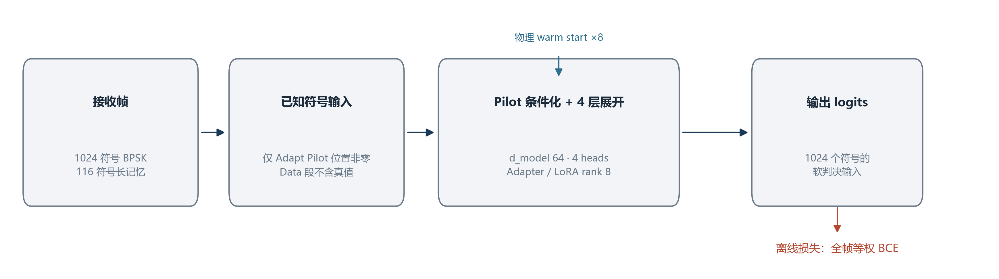
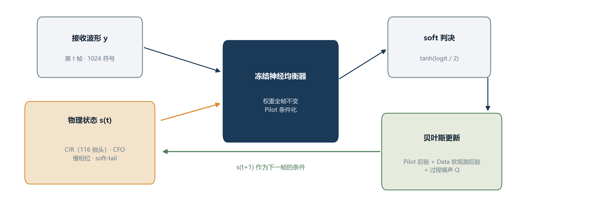
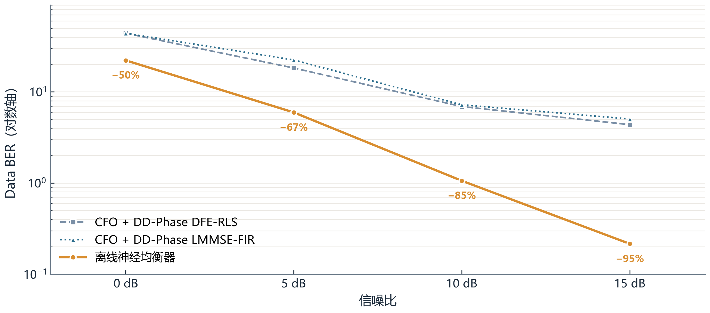
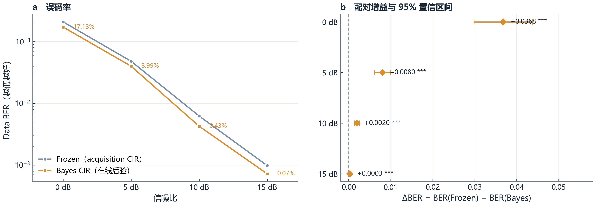
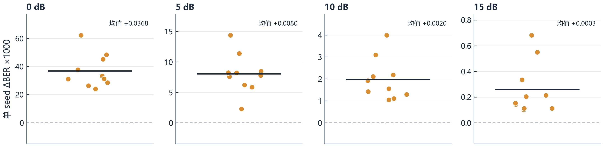
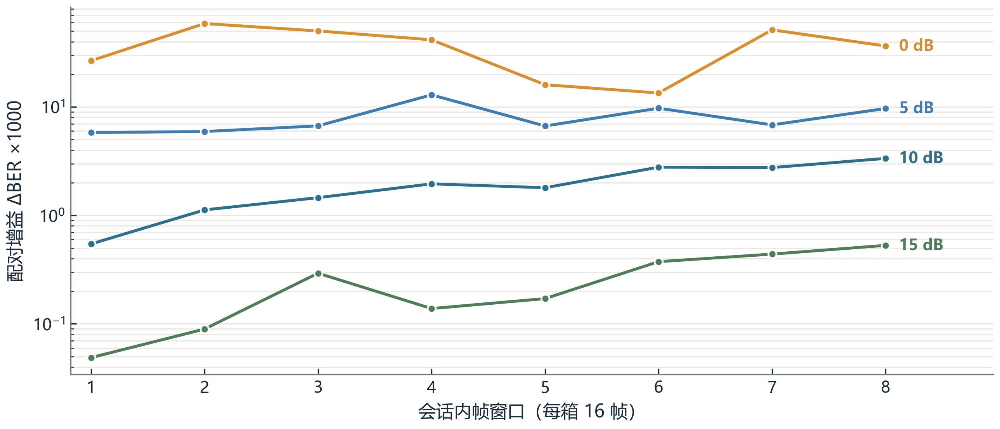
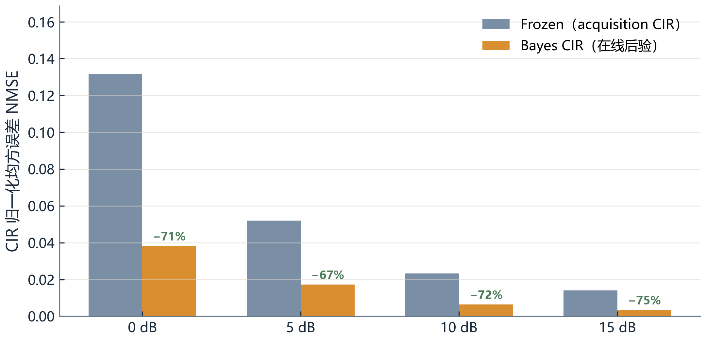
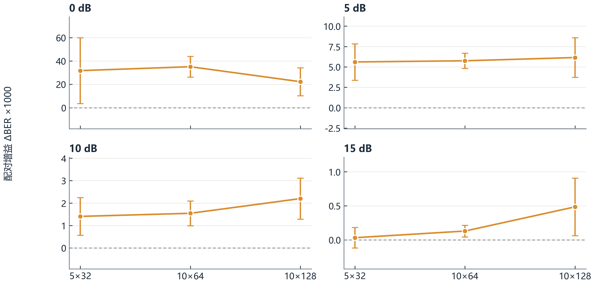

# 长记忆 EME 信道下离线训练与在线贝叶斯 CIR 适配的神经块均衡器

## 摘要

长记忆 EME 信道具有深衰落与长时延，传统均衡器受误差传播限制。本文提出一种离线训练、在线适配物理状态的神经块均衡器：离线训练 Pilot 条件化网络，部署时冻结权重，仅用合法观测递推贝叶斯 CIR 后验。冻结的 10 个独立 session × 128 帧确认显示，0/5/10/15 dB 的配对 BER 增益为 +0.0368、+0.0080、+0.0020、+0.00026，单侧 95% 下界均为正，10/10 session 无负向；CIR NMSE 降低 67%–75%。增益在 5/10/15 dB 随帧增长，0 dB 呈早期收敛而非增长。增益归因于物理状态后验而非神经参数更新。

## 1 引言

月球反射通信（Earth-Moon-Earth, EME）以月球表面作为被动反射体，可在超远距离上建立链路。Evans 的雷达月球观测给出了月球回波的早期测量[1]。在单载波 BPSK 体制下，长回波表现为数十至上百符号的记忆：本文使用的 Level B 配置最大时延为 116 符号，标称相干时间约 1200 s。深衰落与长记忆叠加，使接收端必须在低信噪比下同时完成信道估计、相位跟踪与符号判决。

传统方案以 Pilot 驱动的线性最小均方误差有限冲激响应（LMMSE-FIR）均衡器与判决反馈均衡器（DFE-RLS）为代表。它们在短记忆、慢变信道中有效，但在 116 符号记忆下，前缀 Pilot 可提供的独立方程少于信道抽头数，最小二乘问题欠定；判决反馈又把低信噪比下的错误判决送回滤波器，形成误差传播。本文主矩阵中，0 dB 下 CFO+DD-Phase DFE-RLS 的 Data BER 为 44.05%，LMMSE-FIR 为 44.01%，已接近随机猜测。

神经均衡器提供了另一条路径。ViterbiNet 用神经网络替代 Viterbi 算法中的分支度量[2]；深度展开把迭代估计器的每一步映射为网络层[3]；Pilot 条件化的接收机与元学习进一步减少了推理时所需的 Pilot[4,5]。这些工作说明，离线仿真数据可以训练出强均衡器。本文主矩阵中，离线神经均衡器在 0/5/10/15 dB 的 Data BER 为 22.19%/5.96%/1.06%/0.216%，相对 CFO+DD-Phase DFE-RLS 降低 49.6%–95.1%。三个独立 seed 在每个 SNR 上均给出同向结论。

仿真训练与部署的差异不仅来自噪声实现，还来自 CIR 抽头、相位与 CFO 的随机实现。一个在训练分布内很强的网络，遇到分布外信道时可能同时出现均衡残差与置信度失准；如果只依赖离线权重，接收机没有机制纠正这种失配。在线适配因此是长记忆信道下值得优先考虑的环节。问题在于适配什么：网络权重的维数高、在线缺少标签、更新容易失稳；物理状态的维数低、由 Pilot 与接收波形直接观测，更适合作为在线自由度。

离线训练依赖仿真信道与完整标签，因此上述失配在部署时难以避免。本文因此不把网络权重作为在线自由度。一个更可控的自由度是物理状态：CIR 的维数远低于网络参数，且可由 Pilot 与判决反馈持续观测。于是问题变为：在冻结神经权重的条件下，仅递推 CIR 后验，能否获得可归因、可重复的 Data BER 增益？该增益是否随会话内帧数累积？

本文围绕这两个问题做三件事。第一，给出一个冻结神经块均衡器加贝叶斯 CIR 后验的接收机：离线训练 Pilot 条件化的展开网络；在线只更新 116 维 CIR 的均值与协方差，Data 位置使用模型软判决作为伪观测，并以符号方差构造行噪声，使不可靠符号自动降权。第二，在运行前冻结配置、超参数、checkpoint 与判据，用 10 个独立 session × 128 帧做一次性确认，统计单位为 session 而非帧或 bit。第三，分别报告主效应、逐 SNR 安全护栏与增长假设：H1 与 H2 通过，H3 在 5/10/15 dB 通过、0 dB 不通过。本文的在线自由度仅限物理状态，所有增益均与同源 Frozen 网络配对比较。

## 2 系统与信号模型

### 2.1 信道与帧结构

本文沿用 Level B 长回波配置：单载波、线性 BPSK、1024 符号帧，最大信道时延 116 符号，标称相干时间 1200 s，采用零 acquisition 空档与 cfo_phase_tiny 的慢相位/CFO 设置。每帧前缀为 256 个 Pilot 符号，其中 Adapt Pilot 224 个、Reward Pilot 32 个；其余 768 个为 Data 符号。Pilot 布局、采样率与帧长在所有比较中保持不变，本文不通过修改信道、Pilot 或接收窗口来获得增益。帧预算为 102.4 ms；本文只在成本讨论中使用这一预算，不把它当作物理定律。Pilot 预算在 Frozen、Bayes 与传统基线之间完全一致，任何一方都不能通过增加 Pilot 获得优势。

### 2.2 接收信号模型

设第 t 个符号的发送符号为 $x_t \in \{-1,+1\}$，信道冲激响应为 $\mathbf{h}=[h_0,\ldots,h_{L-1}]^{\mathsf T}$，$L=116$。接收复基带样本写为

$$
y_t = e^{j(2\pi f_{\mathrm{cfo}} t+\varphi_t)}\sum_{l=0}^{L-1} h_l x_{t-l}+n_t,
$$

其中 $f_{\mathrm{cfo}}$ 为载波频偏，$\varphi_t$ 为慢相位，$n_t$ 为复高斯噪声。接收机在整帧上做块均衡：把 1024 个接收样本与已知符号掩码送入网络，输出 1024 个 logits $z_t$，判决为 $\hat{x}_t=\operatorname{sign}(z_t)$。Data BER 只在事后用发送比特评分；BER 与 NMSE 的评价都在会话结束后统一进行，避免评价反馈进入在线循环。

在线阶段，CFO 与慢相位由 Adapt Pilot 及当前 CIR/tail 估计；CIR 的递推见第 4 节。本文不假设已知真实 CIR、相位或 CFO，也不把仿真真值送入任何可部署分支。

### 2.3 Pilot 角色与数据隔离

Adapt Pilot 的已知符号用于在线 CIR 后验与相位/CFO 估计；Reward Pilot 保留为动作后验收集，不进入内循环拟合；Data 段的接收波形参与均衡与判决反馈，但 Data 的发送标签从不进入在线更新、选择、验收或阈值设定。离线训练时，Data 标签只用于反向传播与 checkpoint 选择；确认时只用于事后 BER 与 NMSE 诊断。Pilot、Reward 与 Data 三种角色的数据、seed 与访问时序相互隔离。

## 3 离线神经块均衡器

### 3.1 网络结构与输入输出

网络输入为接收帧 $y_{0:1023}$ 与已知符号掩码：掩码只在 Adapt Pilot 位置填入已知 Pilot 符号，其余位置置零。这样网络在推理时看不到任何 Data 真值，只看到当前帧的合法 Pilot 与接收波形。网络采用 4 层迭代展开结构，隐藏维度 $d_{\mathrm{model}}=64$，4 个注意力头，配置记录为 Adapter/LoRA rank 8，并在每帧执行 8 次物理 warm start。输出层产生 1024 个 logits。整个网络含 189,350 个参数。图 1 给出结构与训练流程。网络输出的是 logits 而不是硬判决；soft 输出既用于最终 BER 评分前的符号判决，也用于在线 Data 后验，同一组 logits 在两个阶段保持相同语义，避免训练与部署之间的接口漂移。

**图 1** 离线神经块均衡器的结构与训练流程。接收帧与仅在 Adapt Pilot 位置非零的已知符号输入共同进入 Pilot 条件化的 4 层展开网络；网络输出 1024 个符号的 logits，离线以全帧等权 BCE 训练。

展开结构的作用是把“信道估计—均衡—判决”的迭代过程变成可学习的层间映射：物理模型提供先验，网络学习难以手工建模的残差。Pilot 条件化使同一组权重可以根据当前帧的 Pilot 观测调整输出，而不需要在部署时更新权重。与把整个接收机视为黑箱的做法相比，展开结构保留了 116 符号长记忆的物理先验，使离线样本需求可控；与纯模型驱动方法相比，它又能从仿真标签中学习难以手工建模的残差。

### 3.2 离线训练目标与数据角色

离线损失为全帧等权二元交叉熵：

$$
\mathcal{L}_{\mathrm{BCE}}=\frac{1}{T}\sum_{t=1}^{T}\left[-b_t\log\sigma(z_t)-(1-b_t)\log(1-\sigma(z_t))\right],
$$

其中 $b_t$ 为发送比特，$\sigma(\cdot)$ 为 sigmoid，$T=1024$。训练使用仿真信道生成的接收帧与完整标签，batch size 为 1，共 32 步；训练日志记录 32 个 `estimated_cir_level_b` 更新步，条件 CIR 来源为 acquisition。checkpoint 的选择指标是独立验证切片的 Data BER，而不是 Pilot BCE。用 Data BER 而不是 Pilot BCE 选择 checkpoint，是为了让离线模型的选择目标与最终指标一致。Pilot BCE 只反映已知符号的拟合，不能代表 Data 段泛化；在长记忆信道中，Pilot 段与 Data 段的残余信道状态不同，若按 Pilot BCE 选择，容易得到在 Pilot 上过拟合、在 Data 上退化的模型。源 checkpoint 的 SHA256 为 `8cd3912d1c957c9689c51730aff9d27a8f74942186c802a7483e5781af65aec4`，元数据记录 `resume_loaded=False`、189,350 参数、`iterations=4`、`d_model=64`、`physics_warm_start_iterations=8`，离线验证 `mean_ber_data≈0.0658`。

需要说明复现边界：原始训练命令、源码 revision、Python/PyTorch/CUDA 环境、完整优化器超参数与显式随机种子没有随 checkpoint 保存。本文给出的训练配置来自配置文件和训练指标的重构，不能称为严格复现。离线主矩阵的结论主要由独立评估支撑，而不是由 4 帧内部验证集单独支撑。

### 3.3 离线饱和与可修复空间

在进入在线设计前，本文先判断离线模型是否已经饱和。在 3 seed × 12 帧的配对评估中，从同一 checkpoint 继续训练 32/64 步，或在相同 32 步预算下把 `iterations` 从 4 增到 6、`d_model` 从 64 增到 96，Frozen Data BER 与原始 checkpoint 基本重合；最大点估计改善仅约 $-1.8\times10^{-4}$（5 dB，64 步续训），对应 12 帧约 1–2 个比特，其余点多数量级为 0 或区间跨零。增加训练步数或模型宽度没有带来可确认的改善。

另一方面，在 5 seed × 8 帧的 oracle 诊断中（seed 91001–91005），把条件 CIR 换成该帧真实 CIR 后，Frozen BER 在 5 dB 从 0.05283 降到 0.04199（$\Delta=-1.08\times10^{-2}$，95% CI $[-1.57\times10^{-2},-5.94\times10^{-3}]$），10 dB 从 0.00700 降到 0.00465（$\Delta=-2.34\times10^{-3}$，CI $[-3.23\times10^{-3},-1.46\times10^{-3}]$）；0 dB 点估计为 $-4.60\times10^{-2}$，5/5 seed 同向，但 seed 91003 的 BER 0.311 使区间跨零；15 dB 近似为 0。这个 oracle 分支不可部署，只用于诊断：它说明 5/10 dB 的剩余误差主要来自 CIR 估计，而不是网络容量或训练预算。在线适配因此应优先作用于物理状态，而不是继续扩大神经模型。这一诊断也解释了为什么本文优先选择在线 CIR 后验，而不是继续增加同分布训练样本：如果剩余误差主要来自 CIR 估计，那么增加同分布训练样本只能改善网络对已有条件的拟合，不能纠正部署时的信道失配。相反，在线 CIR 后验直接作用于失配的来源，且不需要 Data 标签。该判断只适用于本文的 116 符号长回波配置与当前 checkpoint；在其他信道或模型上，误差构成可能不同，需重新做 oracle 诊断。

## 4 在线贝叶斯 CIR 适配

### 4.1 共享物理状态与 Frozen 对照

Frozen 与 Bayes 使用同一 checkpoint、同一 acquisition CIR 先验、同一 `dd_soft` tail 规则与同一接收波形；两臂的神经权重都冻结。Frozen 在整个会话中保持 acquisition CIR 不变；Bayes 只把 CIR 的均值与协方差按合法观测递推。因而两臂的差异被限制在物理状态后验上，BER 差可以归因于 CIR 适配，而不是网络容量、Pilot 预算或训练数据。

`dd_soft` tail 指：用当前帧最后 `max_delay` 个 Data 位置的模型软判决 $\tanh(z_t/2)$ 递推下一帧的信道尾部，与离线课程训练中的 `online_soft` 规则对齐，尺度 $\alpha=1.0$。该规则只读接收波形与模型输出，不读 Data 标签。共享 tail 规则是公平比较的关键。若 Frozen 使用与离线训练不一致的 tail 递推，或 Bayes 额外获得更长的历史，两臂的差异就会混入 tail 协议而不是 CIR 后验。本文在确认前固定 `dd_soft`、$\alpha=1.0$ 与历史长度，使两臂只在 CIR 是否更新上不同；tail 复用与独立前向的逐位一致性也在成本 profile 中单独核对。图 3 给出在线闭环：物理状态条件化冻结网络，网络输出软判决，软判决与 Adapt Pilot 共同进入贝叶斯更新，更新后的状态只用于下一帧。

**图 3** 在线闭环。冻结神经均衡器在物理状态 $s(t)$ 条件下输出软判决；贝叶斯更新利用 Adapt Pilot 与 Data 软观测递推 CIR 后验，所得 $s(t+1)$ 仅用于下一帧。

### 4.2 贝叶斯递归 CIR 后验

把 CIR 视为线性高斯状态，递推分四步。第一步，用 acquisition 帧的已知符号与 ridge $=10^{-2}$ 构造归一化先验均值 $\mathbf{m}_0$ 与协方差 $\boldsymbol{\Sigma}_0$。第二步，对每帧 Adapt Pilot 的已知符号做 Kalman 更新：

$$
\mathbf{K}_t=\boldsymbol{\Sigma}_t\boldsymbol{\phi}_t\left(\boldsymbol{\phi}_t^{\mathsf T}\boldsymbol{\Sigma}_t\boldsymbol{\phi}_t+\sigma^2\right)^{-1},
$$

$$
\mathbf{m}_t\leftarrow\mathbf{m}_t+\mathbf{K}_t\left(y_t-\boldsymbol{\phi}_t^{\mathsf T}\mathbf{m}_t\right),\qquad
\boldsymbol{\Sigma}_t\leftarrow\left(\mathbf{I}-\mathbf{K}_t\boldsymbol{\phi}_t^{\mathsf T}\right)\boldsymbol{\Sigma}_t,
$$

其中 $\boldsymbol{\phi}_t$ 由已知 Pilot 符号组成，$\sigma^2$ 为接收噪声方差。第三步，对 Data 位置使用模型软判决 $\hat{x}_t=\tanh(z_t/2)$ 作为伪观测，观测方程仍为 $y_t=\boldsymbol{\phi}_t^{\mathsf T}\mathbf{h}+n_t$，但行噪声改为

$$
R_t=\sigma^2+\sum_{l=0}^{L-1}|h_l|^2\operatorname{Var}(\hat{x}_{t-l}),\qquad
\operatorname{Var}(\hat{x})=1-\hat{x}^2.
$$

当某个符号的软判决接近 0 时，其方差接近 1，该行在更新中被自动降权；当软判决接近 $\pm1$ 时，方差接近 0，该行接近已知符号。这样，低信噪比下的不可靠符号不会以硬判决的方式污染 CIR，也不需要按真实 SNR 调度。第四步，帧间对协方差加过程噪声 $\boldsymbol{\Sigma}\leftarrow\boldsymbol{\Sigma}+Q\mathbf{I}$，$Q=10^{-4}$，并把更新后的后验只用于下一帧，保持因果。

这一递推与经典 Kalman 滤波同构，区别在于 Data 行的观测是模型软判决而非真值，且行噪声依赖当前 CIR 与软符号方差。Kay 的估计理论给出了线性高斯状态下的最小均方误差更新形式[6]；本文把其用于 CIR 的跨帧递推，并把符号可靠性显式写入观测噪声。一个自然的替代是每帧对 Data 做最小二乘或 ridge 回归。但在 116 维状态、768 个 Data 符号且含错误符号的条件下，设计矩阵条件数很大，硬判决最小二乘会被错误符号主导；简单 Data LS 与 Pilot ridge 在开发诊断中正因欠定、相位残差与错误传播而失败。贝叶斯后验用先验协方差与行噪声正则化，等价于对 Data 行做加权 ridge，并把跨帧信息保留在协方差中。协方差的跨帧收缩解释了增长后饱和：随着帧数增加，后验方差下降，单帧 Data 观测对 CIR 的修正变小；当过程噪声 $Q$ 与信息增量平衡时，增益趋于稳态。0 dB 的后验还受错误传播影响，软符号方差只能部分抑制，不能完全消除。

### 4.3 信息边界与归因

在线可读的量为：已接收波形、Adapt Pilot 已知符号、模型 soft 输出 $\tanh(z/2)$、以及由 Pilot 驱动的 CIR/CFO/相位/tail 估计。在线禁止读取：Data 发送符号或比特、仿真真实 CIR/相位/CFO、Reward Pilot 回流内循环、未来帧标签。Data 段的波形参与均衡与无标签判决反馈，但 Data 标签不进入任何在线更新、选择、验收或阈值设定；Data 后验使用的是模型软判决作为伪观测，不是真值。Reward Pilot 只在动作后用于验收，本文的 CIR 递推不读取它。真实 CIR 只用于事后 NMSE/oracle 诊断，Data 标签只用于事后 BER。

归因上，Frozen 与 Bayes 共享 checkpoint、acquisition 先验、tail 规则、Pilot 预算与波形，唯一差异是 CIR 后验。因此本文报告的增益是物理状态增益，不是网络权重更新带来的增益。本文的全部在线适配都作用于 CIR 后验；网络权重在部署阶段保持冻结。从信息使用角度看，Frozen 只使用 acquisition 帧构造一次 CIR；Bayes 使用每帧 Adapt Pilot 与 Data 波形，但把这些观测压缩到 116 维状态后验中，而不是写入网络权重。两臂接收到的波形相同，差别在于是否让跨帧观测改变状态估计。

### 4.4 复杂度与因果性

每帧的贝叶斯更新只涉及 116 维状态与 1024 个观测行，Pilot 后验与 Data 后验合计约 30 ms（当前 GPU 的 profile：Pilot 8.6–10.4 ms，Data 19.3–21.7 ms）。主要成本仍在冻结网络前向：单次前向约 400 ms；tail 若独立前向再加约 400 ms，总耗时约 830 ms；tail 复用与独立前向逐位一致，可把总耗时降到约 435 ms，约为 102.4 ms 帧预算的 4.2 倍。因此当前实现不满足实时性，模型前向是瓶颈。本文把逐帧延迟与显存列为待补的工程项，而不是已完成的指标。因果性方面，第 $t$ 帧的判决只使用第 $t$ 帧及之前的观测与第 $t-1$ 帧结束时的 CIR 后验；更新后的 CIR 不用于重新解码本帧。这个时序约束使 Bayes 与 Frozen 的差异不来自“看了答案再改”，也使确认结果可以与在线部署的因果流程对应。

## 5 实验设置

### 5.1 确认设计与预注册判据

确认协议在运行前冻结（2026-11-06）。配置为 `eme_long_memory_v2_online_dd_tail_v1.json`；checkpoint 为第 3 节的强离线模型，SHA256 为 `8cd3912d…aec4`；贝叶斯超参数固定为 acquisition ridge $=10^{-2}$、过程噪声 $Q=10^{-4}$、Data 行噪声尺度 1.0，不按真实 SNR 调度。确认使用 10 个独立 session（seed 100001–100010），每个 session 连续 128 帧，覆盖 0/5/10/15 dB；开发 seed 90001–99010 全部排除。确认集只运行一次；看到结果后不得调参、换 seed 或改判据。开发 seed 与确认 seed 完全不重叠；确认 seed 在协议中预先指定，没有参与 checkpoint 选择、超参数搜索或基线校准。Reward Pilot 在确认中不进入 CIR 递推，只保留为动作后验收；因此确认结果不依赖任何 Data 标签回流。

三个假设如下。H1（主效应）：四个 SNR 等权、session 级平均增益
$\Delta_s=\operatorname{mean}_{\mathrm{sessions}}(\mathrm{BER}_{\mathrm{frozen},s}-\mathrm{BER}_{\mathrm{bayes},s})>0$，单侧检验，$\alpha=0.05$。H2（安全护栏）：每个 SNR 的单侧 95% 下界不小于 0，点估计不得为负，允许退化量为 0；四个 SNR 用 Holm 校正。H3（增长）：每个 SNR 的 16 帧窗口增益
$\mathrm{gain}_w=\mathrm{BER}_{\mathrm{frozen},w}-\mathrm{BER}_{\mathrm{bayes},w}$，会话级斜率与末窗减首窗为正；逐 SNR 报告，不用四 SNR 平均掩盖 0 dB 的饱和或波动。

### 5.2 统计单位与功效

统计单位是独立 session，不是帧，也不是 bit。对每个 session 先计算配对增益
$d_s=\operatorname{mean}_t(e_{\mathrm{frozen},t}-e_{\mathrm{bayes},t})/768$，再对 $n$ 个 session 做单侧 $t$ 检验；置信界用 $t$ 分布而非正态近似。这样做的原因是逐帧错误数严重过离散：主矩阵中 0 dB 的方差/均值比为 70.6，设计效应约 90.7；5/10/15 dB 的设计效应分别为 2.25、2.58、1.77。若把 bit 当作独立 Bernoulli，置信区间会窄几个数量级。

功效分析给出了确认设计的依据。以 $n=3$、$F=128$ 的开发口径，80% power 的最小可检出效应在 0/5/10/15 dB 约为 $4.51\times10^{-3}$、$9.97\times10^{-4}$、$3.28\times10^{-4}$、$1.37\times10^{-4}$；本文确认观测到的 $d_s$ 均值分别为 $3.68\times10^{-2}$、$8.03\times10^{-3}$、$1.97\times10^{-3}$、$2.60\times10^{-4}$，均高于该 MDE 约 2–8 倍。另一方面，$1\times10^{-5}$ 的效应在 128 帧 session 上只相当于约 0.98 个净错误；在 3 session × 32 帧、共 73,728 bit 上，1 个净错误就是 $1.36\times10^{-5}$。因此本文不把 $1\times10^{-5}$ 量级的点估计当作连续效应，也不以它作为确认目标。10 个 session 的选择不是事后凑样本，而是在运行前根据功效分析固定。若把目标设为 $10^{-5}$，0/5 dB 需要 $10^{4}$–$10^{5}$ 个独立 session，实际不可行；本文因此把确认目标设为与物理机制相称的 $10^{-3}$–$10^{-4}$ 量级，并在运行前固定 session 数与帧数。

### 5.3 开发筛查与基线

正式确认前，本文使用四组开发 seed 做规模筛查：3×16（95001–95003）、5×32（97001–97005）、10×64（98001–98010）、10×128（99001–99010）。这些结果只用于设计，不并入确认。传统基线包括 CFO+DD-Phase LMMSE-FIR、CFO+DD-Phase DFE-RLS 与 SC-FDE-MMSE；前两者使用合法 Pilot 做 CFO/相位补偿，不使用神经网络或强化学习；SC-FDE-MMSE 未做 CFO/相位补偿，只作弱对照。所有比较共享同一 episode、同一接收波形、同一 Pilot 预算（256：Adapt 224 / Reward 32）与同一 acquisition CIR。传统基线的 CFO/相位补偿使用与 Frozen/Bayes 相同的 Pilot 预算，但其滤波器系数由各自规则在线估计；本文不向传统方法提供真实 CIR、Data 标签或 Reward Pilot。SC-FDE-MMSE 只作弱对照，因为它在当前配置下没有做 CFO/相位补偿。这样的对照不能证明传统方法的最优实现，但能说明本文的增益不是在“传统方法被削弱”的条件下取得的。

## 6 结果

### 6.1 离线均衡器相对传统基线

先看离线模型的均衡能力。表 1 与图 2 给出 3 seed × 60 帧主矩阵的 Data BER。离线神经均衡器在 0/5/10/15 dB 为 22.19%/5.96%/1.06%/0.216%；CFO+DD-Phase DFE-RLS 为 44.05%/18.30%/6.91%/4.37%；LMMSE-FIR 为 44.01%/22.43%/7.22%/5.05%。相对 DFE-RLS，四个 SNR 的 BER 降低分别为 49.6%、67.4%、84.7%、95.1%。三个独立 seed 中，每个 SNR 的 Frozen 都低于该传统基线。

| SNR | 离线神经均衡器 | CFO+DD-Phase DFE-RLS | CFO+DD-Phase LMMSE-FIR | 相对 DFE-RLS 降低 |
|---:|---:|---:|---:|---:|
| 0 dB | 22.19% | 44.05% | 44.01% | 49.6% |
| 5 dB | 5.96% | 18.30% | 22.43% | 67.4% |
| 10 dB | 1.06% | 6.91% | 7.22% | 84.7% |
| 15 dB | 0.216% | 4.37% | 5.05% | 95.1% |

表 1 离线神经均衡器与传统均衡器在 3 seed × 60 帧主矩阵上的 Data BER。相对降低以 CFO+DD-Phase DFE-RLS 为参照。

**图 2** 离线神经均衡器与传统均衡器在 3 seed × 60 帧主矩阵上的 Data BER。标注为相对 CFO+DD-Phase DFE-RLS 的 BER 降低比例。

这张表说明离线模型提供了强均衡起点，但它不是在线增益的证据。主矩阵的统计单位仍是独立 session；每个 SNR 只有 3 个 seed，不能把 180 帧当作 180 个独立样本来夸大显著性。本文的在线主张只与同源 Frozen 比较，见 6.2 节。

### 6.2 独立确认的主效应与安全护栏

表 2 与图 4 给出确认结果。四个 SNR 的 session 级配对增益均为正：0 dB $+0.036802$（SE $3.55\times10^{-3}$，单侧 95% 下界 $+0.030289$），5 dB $+0.008032$（SE $9.64\times10^{-4}$，下界 $+0.006265$），10 dB $+0.001971$（SE $2.81\times10^{-4}$，下界 $+0.001456$），15 dB $+0.000260$（SE $6.06\times10^{-5}$，下界 $+0.000149$）。Holm 校正后的 $p$ 值分别为 $1\times10^{-5}$、$2\times10^{-5}$、$6\times10^{-5}$、$1\times10^{-3}$；每个 SNR 均为 0/10 个负向 session。H1 的四 SNR 等权平均增益为 $+0.011767$（SE $8.61\times10^{-4}$，单侧下界 $+0.010188$，$p=1.26\times10^{-7}$）。H2 在四个 SNR 上均通过。

| SNR | Frozen BER | Bayes BER | ΔBER | SE | 单侧 95% 下界 | Holm $p$ | 负向 session |
|---:|---:|---:|---:|---:|---:|---:|---:|
| 0 dB | 0.2081 | 0.1713 | +0.036802 | $3.55\times10^{-3}$ | +0.030289 | $1\times10^{-5}$ | 0/10 |
| 5 dB | 0.0479 | 0.0399 | +0.008032 | $9.64\times10^{-4}$ | +0.006265 | $2\times10^{-5}$ | 0/10 |
| 10 dB | 0.00623 | 0.00426 | +0.001971 | $2.81\times10^{-4}$ | +0.001456 | $6\times10^{-5}$ | 0/10 |
| 15 dB | 0.000985 | 0.000724 | +0.000260 | $6.06\times10^{-5}$ | +0.000149 | $1\times10^{-3}$ | 0/10 |

表 2 独立确认 v1 的逐 SNR 配对结果。ΔBER 定义为 $\mathrm{BER}_{\mathrm{frozen}}-\mathrm{BER}_{\mathrm{bayes}}$；下界为单侧 95% $t$ 下界（df=9）。

**图 4** 独立确认 v1 的 BER 曲线与逐 SNR 配对增益森林图。左：Frozen 与 Bayes 的四 SNR 平均 BER；右：session 级配对 ΔBER 与双侧 95% 置信区间（1.96×SE）。

这里的下界是单侧 95% $t$ 下界（df=9）；图 4b 画的是双侧 95% 区间（$1.96\times\mathrm{SE}$），两者口径不同，但都远离零。需要强调，0 dB 的绝对 BER 仍为 17.13%，远高于 5 dB 的 3.99%；增益显著不等于链路可用。本文报告的是相对同源 Frozen 的改善，而不是绝对性能承诺。把 ΔBER 换成净错误数可以避免过度解读。在 128 帧 × 768 bit 的 session 上，0 dB 的增益远大于单个 bit 的偶然翻转；15 dB 的效应虽小，但仍对应可计数的净错误，而不是一个 bit 的噪声。本文在报告均值的同时保留逐 session 分布，原因正在于此。

### 6.3 会话级一致性

图 5 给出 10 个 session 的配对增益分布。四个 SNR 的 10 个点全部位于零线以上，没有负向 session；0 dB 的 session 间散布最大，5/10/15 dB 逐渐收紧。0 dB 的单 session 增益范围较宽，这与该 SNR 的深衰落和错误传播一致；但 10 个 session 的均值仍远离零，单侧下界为 $+0.0303$。5 dB 的均值 $+0.0080$、下界 $+0.0063$；10 dB 的均值 $+0.0020$、下界 $+0.0015$；15 dB 的均值 $+0.00026$、下界 $+0.00015$。后两个 SNR 的效应绝对值很小，但在配对设计和 10 个 session 下仍可分辨。

**图 5** 10 个独立 session 的配对增益分布。每个点为一个 session 的 ΔBER；横线为 10 session 均值。

### 6.4 增益随帧演化

表 3 与图 6 给出 16 帧窗口的配对增益。5 dB 的窗口从 $+0.0058$ 上升到 $+0.0097$，斜率 $+0.000410$/bin；10 dB 从 $+0.00055$ 上升到 $+0.00335$，斜率 $+0.000377$/bin；15 dB 从 $+0.00005$ 上升到 $+0.00053$，斜率 $+0.000064$/bin；三者均满足 H3。0 dB 的窗口为 $+0.0267$、$+0.0587$、$+0.0502$、$+0.0416$、$+0.0160$、$+0.0134$、$+0.0513$、$+0.0365$，斜率 $-0.001238$/bin；末窗减首窗为 $+0.0098$，但由于第 2 窗的早期峰值，斜率仍为负。按预注册判据，H3 在 0 dB 不通过。

| SNR | 16 帧窗口增益（Frozen−Bayes） | 斜率/bin | 首窗 / 末窗 | H3 |
|---:|---|---:|---:|---:|
| 0 dB | +0.0267, +0.0587, +0.0502, +0.0416, +0.0160, +0.0134, +0.0513, +0.0365 | −0.001238 | +0.0267 / +0.0365 | 不通过 |
| 5 dB | +0.0058, +0.0059, +0.0067, +0.0129, +0.0067, +0.0097, +0.0068, +0.0097 | +0.000410 | +0.0058 / +0.0097 | 通过 |
| 10 dB | +0.00055, +0.00112, +0.00146, +0.00195, +0.00180, +0.00278, +0.00276, +0.00335 | +0.000377 | +0.00055 / +0.00335 | 通过 |
| 15 dB | +0.00005, +0.00009, +0.00029, +0.00014, +0.00017, +0.00037, +0.00044, +0.00053 | +0.000064 | +0.00005 / +0.00053 | 通过 |

表 3 独立确认 v1 的 16 帧窗口增益与会话级斜率。H3 要求斜率与末窗减首窗均为正；0 dB 的末窗减首窗为正，但斜率因第 2 窗早期峰值而为负。

**图 6** 配对增益随会话内帧窗口的演化。每箱 16 帧；0 dB 呈早期峰值后波动，5/10/15 dB 总体上升。

0 dB 的形状应描述为“早期收敛、随后波动/饱和、晚窗仍为正”，而不是“随帧增长”。四 SNR 平均 $+0.011767$ 不能用来掩盖这一点；本文在摘要、结果与结论中都单独报告 0 dB 的 H3 失败。5/10/15 dB 的增长与“后验协方差随帧收缩、过程噪声设定稳态”的解释一致；0 dB 的早期峰值则提示低 SNR 下的软判决后验在最初几帧快速吸收信息，随后被错误传播与信道波动主导。0 dB 的失败不是符号错误，而是形状错误：增益的符号在 10/10 session 上一致为正，但窗口斜率因早期峰值而为负。若只看末窗减首窗，会误以为 0 dB 也满足增长；预注册判据同时要求斜率与末窗减首窗为正，正是为了防止这种选择性解读。

### 6.5 CIR 估计误差

表 4 与图 7 给出 CIR 的 NMSE。Frozen 的 NMSE 为 0.1317/0.0520/0.0233/0.0141，Bayes 为 0.0383/0.0173/0.0065/0.0035；四个 SNR 分别下降约 71%、67%、72%、75%，整体在 67%–75% 之间。这与 6.2 的 BER 增益方向一致：0 dB 的 NMSE 绝对下降最大（0.1317→0.0383），其 BER 增益也最大；10/15 dB 的 NMSE 绝对下降较小，BER 增益也较小。

| SNR | Frozen NMSE | Bayes NMSE | 下降 |
|---:|---:|---:|---:|
| 0 dB | 0.1317 | 0.0383 | 70.9% |
| 5 dB | 0.0520 | 0.0173 | 66.7% |
| 10 dB | 0.0233 | 0.0065 | 72.1% |
| 15 dB | 0.0141 | 0.0035 | 75.2% |

表 4 Frozen 与 Bayes 的 CIR 归一化均方误差。下降比例由表中数值计算。

**图 7** Frozen 与 Bayes 的 CIR 估计 NMSE。标注为相对 Frozen 的下降比例。

NMSE 不是本文的主判据，但它提供了机制证据：Bayes 与 Frozen 的唯一差异是 CIR 后验，NMSE 的下降说明后验确实在跟踪信道，而不是通过其他路径改变判决。真实 CIR 只用于离线 oracle 诊断，不进入在线分支。

### 6.6 开发规模一致性

图 8 与表 5 汇总三种开发规模：5×32、10×64、10×128。5/10 dB 的增益在三种规模上均为正，且随规模增大保持同向；15 dB 从 5×32 的中性（$+0.000033$）增长到 10×64 的 $+0.00013$、10×128 的 $+0.00049$，说明长会话对高 SNR 的小效应更重要；0 dB 的点估计在 $+0.0223$ 到 $+0.0351$ 之间波动，主要由 session 间方差主导，但三种规模均为正。3×16 的开发筛查也给出 3/3 seed 同向（0 dB 点估计 $+0.0297$，5 dB $+0.00697$，10 dB $+0.00185$，15 dB 中性）。这些开发结果不能替代 10×128 的独立确认，但说明确认结果不是单一规模或单一 seed 族的偶然产物。开发规模的扩展还说明，0 dB 的点估计不稳定主要来自 session 方差，而不是机制方向改变：3×16、5×32、10×64、10×128 四组开发 seed 的符号均为正。5/10 dB 的点估计在四组开发 seed 上分别处于 $+0.0056$–$+0.0070$ 与 $+0.0014$–$+0.0022$ 之间，随规模增大没有反向；15 dB 的 5×32 点估计接近零，10×64 与 10×128 才给出可辨认的正增益。

| 规模 | seed | 0 dB | 5 dB | 10 dB | 15 dB |
|---|---:|---:|---:|---:|---:|
| 3×16 | 95001–95003 | +0.0297（3/3 同向） | +0.00697 | +0.00185 | 中性 |
| 5×32 | 97001–97005 | +0.0318 | +0.00561 | +0.00141 | 中性 |
| 10×64 | 98001–98010 | +0.0351 | +0.00575 | +0.00155 | +0.00013 |
| 10×128 | 99001–99010 | +0.0223 | +0.00615 | +0.00220 | +0.00049 |

表 5 不同开发规模上的 session 级配对增益。区间与逐 seed 细节见开发归档；这些 seed 不并入确认。

**图 8** 三种开发规模（5×32、10×64、10×128）上的配对增益一致性。误差棒为描述性 95% 区间。

### 6.7 与传统接收机的公平对照

为判断物理增益是否只是在弱基线上有效，本文在 3 seed × 16 帧的开发对照中（seed 130001–130003），把 Frozen/Bayes 与同波形、同 Pilot 预算、同 acquisition CIR 的传统接收机比较。0 dB 的 Data BER：Bayes 18.14%、Frozen 21.46%、CFO+DD-Phase LMMSE-FIR 43.66%、DFE-RLS 40.64%、SC-FDE-MMSE 49.06%；10 dB：Bayes 0.727%、Frozen 0.814%、LMMSE-FIR 4.13%、DFE-RLS 3.59%、SC-FDE-MMSE 48.42%。传统接收机不读 Reward/Data 标签，也不使用神经网络或强化学习；逐 (seed, frame) 配对差（传统−Bayes、传统−Frozen）全部为正，每个 SNR 48 对。SC-FDE-MMSE 未做 CFO/相位补偿，接近随机，只作弱对照。该对照是开发规模，不是确认级证据；它说明本文的起点不是弱基线，但传统方法的确认级比较仍需更大样本。公平性检查包括：同帧接收波形哈希一致、Frozen 与传统方法共享同一 acquisition CIR、传统方法 `uses_neural_network=False`、`uses_reward_or_data_labels=False`。这些检查排除了传统基线通过读取标签或使用不同波形获得优势的可能。

## 7 讨论与局限

### 7.1 增益来源与机制

本文的增益可以分解为三步。第一，离线网络提供了强均衡表示：在同一波形与 Pilot 条件下，它相对 DFE-RLS 低 49.6%–95.1% 的 BER，相对 LMMSE-FIR 也保持同向优势。第二，CIR 后验把每帧的 Pilot 与 Data 软判决转化为对 116 维物理状态的修正；NMSE 下降 67%–75%，说明后验在跟踪信道。第三，跨帧协方差与过程噪声使修正随帧累积，并在信息增量与过程噪声平衡时饱和。5/10/15 dB 的窗口增长与这一机制一致；0 dB 的早期峰值则说明低 SNR 下信息吸收快，但随后被错误传播与信道波动抵消。

一个自然的替代解释是：Bayes 只是多用了 Pilot。这个解释不成立，因为 Frozen 与 Bayes 使用同一 Pilot 预算、同一 acquisition CIR 与同一 tail 规则；Bayes 的额外信息来自 Data 软判决与跨帧后验，而不是更多 Pilot。第二个替代解释是：Bayes 只是多算了算力。两臂共享同一网络前向，Bayes 只增加约 30 ms 的后验；增益不能由网络容量或额外神经参数解释。第三个替代解释是：确认 seed 被挑选。确认 seed 在运行前冻结，10/10 session 无负向，且开发 seed 全部排除；看到结果后没有换 seed 或调参。归因的关键不是 Bayes 用了更多观测，而是它把观测组织成状态后验。Frozen 与 Bayes 的接收波形、Pilot 预算、checkpoint 与 tail 规则完全相同；若增益来自波形或 Pilot，两臂应同时受益。实际观察到的差异只出现在 CIR 后验臂，且 NMSE 与 BER 同向变化，这支持物理状态解释。

### 7.2 与既有工作的关系

本文与三类工作相关。模型驱动的深度接收机把物理模型嵌入网络，ViterbiNet 与深度展开是代表[2,3]；本文的离线网络同样采用展开结构，但在线阶段不更新网络，而是更新物理状态。Pilot 条件化与元学习接收机关注“用少量 Pilot 快速适应”[4,5]；本文把适应对象从网络参数换成 CIR 后验，因而避免了在线标签与网络权重失稳。经典估计理论给出了线性高斯状态的最优递推[6]；本文的做法是把 Data 软判决的符号方差写入行噪声，使无标签的判决反馈可以安全地进入 CIR 更新。三者的结合点在于：离线表示负责“怎么均衡”，在线物理状态负责“当前信道是什么”，两者解耦后，在线更新只需要低维、可辨识且可解释的状态量。

与更新网络权重相比，本文的在线自由度只有 116 维 CIR 的均值与协方差，参数量远小于网络；这不是因为“占比小”就自然可辨识，而是因为 CIR 由 Pilot 与接收波形直接观测，且在 116 符号记忆下仍可由 ridge/贝叶斯先验正则化。本文的全部在线更新都作用于物理状态，不能由本文结果外推网络权重的在线行为。

### 7.3 局限

第一，0 dB 的 H3 不通过。0 dB 的增益最大且 10/10 session 为正，但窗口斜率为 $-0.001238$/bin，形状是早期收敛、随后波动/饱和，而不是持续增长。四 SNR 平均不能掩盖这一点。主矩阵中 0 dB 的 session 间方差也最大（设计效应约 90.7），10 个 session 对斜率估计仍偏少；若要把 0 dB 写成“增长”，需要新的预注册判据与更多独立 session，不能用本次数据重测。15 dB 的每帧错误数很少，session 级均值对单个错误更敏感；这也是该点绝对效应小、但仍需报告逐 session 分布的原因。10 个 session 足以检出本文观测到的效应，但不足以稳定估计 0 dB 的斜率；后续若要做更窄的区间，应增加独立 session，而不是增加同一 session 的帧数。

第二，确认范围有限。确认只运行一次，样本为 10 session × 128 帧；15 dB 的效应仅 $+0.000260$，虽然单侧下界为正，但绝对错误数很少，估计对 session 波动敏感。实验基于仿真信道，116 符号时延、1200 s 相干时间与慢相位/CFO 都是建模假设，尚未在实测 EME 数据上验证；本文也没有做 CIR 漂移、强径数或弥散比例的单因素外推。把这些物理参数标记为文献/测量来源、建模假设或机制变量，是后续工作的一部分。

第三，实时性未完成。确认脚本没有记录逐帧延迟与 GPU 显存；成本来自单独的 profile（1 seed × 4 SNR × 8 帧）：模型前向约 400 ms，Pilot/Data 后验合计约 30 ms，tail 独立前向约 400 ms，总耗时约 830 ms；tail 复用与独立前向逐位一致，可降到约 435 ms，约为 102.4 ms 帧预算的 4.2 倍。warm-start 与 AMP 扫描没有免费加速：只有 warm-start 8 满足四 SNR 不退化，warm-start 4 在 0/5 dB 更好但在 10/15 dB 退化，warm-start 2 更差，AMP 在 GTX 1650 上无 BER 变化也无加速。因此当前实现不实时，模型前向是剩余瓶颈。

第四，离线复现链不完整。原始训练命令、源码 revision、Python/PyTorch/CUDA 环境、完整优化器超参数与显式随机种子没有随 checkpoint 保存；本文给出的训练配置是重构，不是严格复现。checkpoint 与原始大日志也不在当前工作树内，需要恢复资产后才能独立重跑主矩阵。

第五，传统对照的确认级证据仍缺。3 seed × 16 帧的公平对照说明 Frozen/Bayes 在四 SNR 上均优于 CFO+DD-Phase LMMSE/DFE，但样本仍是开发规模；SC-FDE-MMSE 未做 CFO/相位补偿，只作弱对照。传统方法的确认级比较需要与本文确认同量级的 session 数。

第六，Data 软判决的后验仍有错误传播。符号方差项能降低不可靠符号的权重，但不能消除低 SNR 下的深错误；0 dB 的绝对 BER 仍为 17.13%。此外，`block_phase` 相位块更新在 10×64、10 个新开发 seed 上相对 soft 后验没有可归因增量（causal 四 SNR 配对区间全跨零，same-frame 仅 5 dB 为 $+3.4\times10^{-4}$），因此本文保留 soft 后验作为主方法。同帧重解码的绝对增益更高，但它与“用本帧更新后的 CIR 重新解码本帧”的时序绑定，与本文的跨帧因果协议不同；本文只报告因果结果。

### 7.4 未来方向

下一步有三项。其一，在实测 EME 或更完整的信道测量上复核 116 符号记忆、相干时间与慢相位假设，并把 CIR 漂移、CFO 与强径数作为单因素外推，而不是静默改变当前协议。其二，把物理状态后验做成可部署的实时模块：优先复用 tail 前向（已证明逐位一致），再对模型前向做蒸馏、剪枝、重训、批处理或更大 GPU 的工程优化；在 102.4 ms 预算下，当前 4.2 倍差距需要约 4 倍以上的加速。其三，扩展 session 数与帧数，专门检验 0 dB 的早期收敛/饱和形状与高 SNR 的小效应；若要做增长判据，应在看到新数据前冻结窗口定义与样本量。任何后续扩展都应沿用本文的数据角色隔离与一次性确认规则：开发集用于设计与校准，确认集只运行一次；若改变信道、Pilot、窗口或超参数，应视为新方法并重新预注册。只有在这种约束下，物理状态增益与网络权重增益才能被分开归因。

## 8 结论

本文研究了长记忆 EME 信道下“离线训练 + 在线贝叶斯 CIR 适配”的神经块均衡器。离线阶段用仿真信道与完整标签训练 Pilot 条件化的展开网络；部署阶段冻结全部神经权重，仅用合法观测递推 CIR 后验。独立确认 v1 显示：四个 SNR 的配对 BER 增益均为正，H1 与 H2 通过；增益在 5/10/15 dB 随帧增长，0 dB 不通过增长判据，呈早期收敛/后段饱和。CIR 的 NMSE 下降 67%–75%，支持“增益来自物理状态后验”的归因。

本文的结论有明确边界：确认只运行一次，样本为 10 session × 128 帧；0 dB 的 H3 失败不能被平均掩盖；当前实现约 830 ms/帧（tail 复用约 435 ms），相对 102.4 ms 帧预算不实时；实验基于仿真信道，尚未在实测 EME 数据上验证；部署阶段网络权重保持冻结。把物理状态后验做成可部署的实时模块，并在实测信道与漂移场景中复核，是下一步工作。

## 参考文献

[1] Evans, J. V. Radar studies of the Moon. *Journal of Research of the National Bureau of Standards, Section D: Radio Science*, 69D(12):1637, 1965.

[2] Shlezinger, N., Farsad, N., Eldar, Y. C., Goldsmith, A. J. ViterbiNet: A deep learning based Viterbi algorithm for symbol detection. *IEEE Transactions on Wireless Communications*, 19(5):3319–3331, 2020. arXiv:1905.10750.

[3] Hershey, J. R., Le Roux, J., Weninger, F. Deep unfolding: Model-based inspiration of novel deep architectures. arXiv:1409.2574, 2014.

[4] Park, S., Jang, H., Simeone, O., Kang, J. Learning to demodulate from few pilots via offline and online meta-learning. *IEEE Transactions on Signal Processing*, 69:226–239, 2021. arXiv:1908.09049.

[5] Cohen, K. M., Park, S., Simeone, O., Shamai, S. Bayesian active meta-learning for reliable and efficient AI-based demodulation. *IEEE Transactions on Signal Processing*, 70:5366–5380, 2022. arXiv:2108.00785.

[6] Kay, S. M. *Fundamentals of Statistical Signal Processing: Estimation Theory*. Prentice Hall, 1993.
